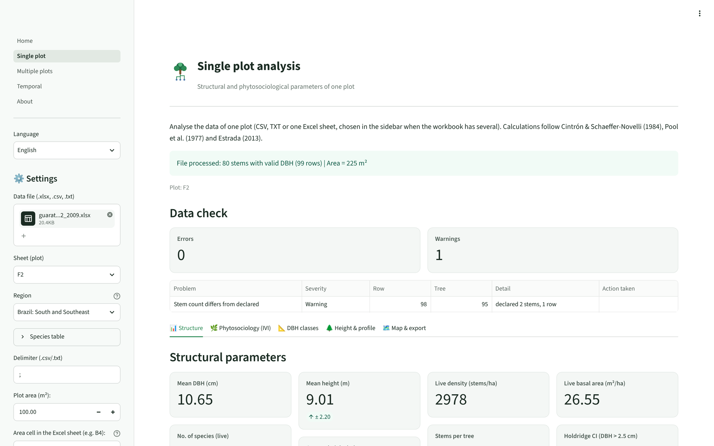

# MangueTREE

MangueTREE is a Python engine and a Streamlit app for the structural and phytosociological analysis of mangrove forest plots. It reads field spreadsheets (one row per stem) and computes density, basal area, mean DBH, tree height, mortality, relative density, dominance and frequency, the importance value (IVI), DBH classes and the Holdridge complexity index. It is meant for researchers and managers who survey mangrove plots with the stem-based protocol of Cintrón & Schaeffer-Novelli (1984).



## Features

- Forest structure per plot: live and dead density (stems/ha), basal area (m²/ha), mean DBH, mean, minimum, maximum and canopy height, stems per tree, mortality.
- Phytosociology per species: relative density, relative dominance, relative and absolute frequency and the IVI.
- Holdridge complexity index, computed for DBH > 2.5 cm and DBH > 10 cm.
- DBH classes with user-defined cutoffs, and regular diameter classes with De Liocourt's quotient.
- Multiple plots: spatial comparison and IVI with the plots as sampling units.
- Time series: plots surveyed over the years (one workbook per plot, several together), every plot and species parameter, live and dead by species with the dead part hatched, comparison between plots.
- Summary panel of a plot, interactive, downloadable as PNG or PDF.
- Data validation before the analysis, with a report of every issue found and the action taken.
- Exports: PDF reports, Excel tables, CSV files and every figure of a tab as PNG (ZIP, chosen DPI).
- Data template (Portuguese or English, Excel or CSV) on the home page.
- Interface and exports in Portuguese and English.
- Species table for the Neotropics (ten taxa, four regions) that users can edit and extend.

## Download

The easiest way to use MangueTREE is the desktop app. It needs no Python and no command line.

| System | Download |
|---|---|
| Windows 10 or 11 | [MangueTREE-Windows.zip](https://github.com/luq317/MangueTREE/releases/latest/download/MangueTREE-Windows.zip) |
| macOS | [MangueTREE-macOS.zip](https://github.com/luq317/MangueTREE/releases/latest/download/MangueTREE-macOS.zip) |

All versions and their notes are on the [Releases page](https://github.com/luq317/MangueTREE/releases).

**Windows.** Unzip the file, open the `MangueTREE` folder and double-click `MangueTREE.exe`. If Windows shows "Windows protected your PC", click *More info* and then *Run anyway* (the app is not signed with a paid certificate).

**macOS.** Unzip the file and move `MangueTREE.app` to the Applications folder. The first time, right-click the app and choose *Open*, then confirm *Open* again (the app is not notarised by Apple). After that it opens with a double-click.

The app opens in your web browser, but it runs on your computer and works offline. Your spreadsheets are not sent anywhere. To close it, use the *Quit MangueTREE* button in the sidebar.

## Installation from source (for developers)

MangueTREE needs Python 3.11 or newer.

```bash
git clone https://github.com/luq317/MangueTREE.git
cd MangueTREE
pip install -r requirements.txt
pip uninstall -y manguetree   # requirements.txt installs a fixed copy; replace it
pip install -e .               # editable: the app reads your working copy
```

How the desktop builds are made is described in [docs/installers.md](docs/installers.md).

## Quick start

### The app

```bash
manguetree
```

The `manguetree` command starts the app on `http://localhost:8501` and opens the browser. During development you can also run:

```bash
streamlit run src/manguetree/app/Home.py
```

The app has three analysis pages (single plot, multiple plots, temporal) and an About page. Upload one of the example files from `data/`, choose the region, and read the results. See the [user guide](docs/user-guide.md).

### The engine as a library

The example below analyses plot F2 of the Guaratiba example data (surveyed in 2009).

<!-- readme-example -->
```python
from manguetree import calc
from manguetree.io import load_excel_sheet
from manguetree.species import SpeciesResolver, load_species_table, load_genus_defaults

df, area = load_excel_sheet("data/guaratiba_T2_2009.xlsx", "F2")
resolver = SpeciesResolver(load_species_table(), "BR_S_SE", load_genus_defaults())
res = calc.analyze(df, area, resolver, plot_name="F2")

s = res["summary"]
print(f"Live density: {s['density_live_ha']:.1f} stems/ha")
print(f"Live basal area: {s['ba_live_ha']:.2f} m2/ha")
cols = ["species", "n_stems", "rel_density", "rel_dominance"]
print(res["importance"][cols].round(1).head())
```

`calc.analyze` returns a dictionary with the cleaned stem table (`data`), the plot summary (`summary`), the per-species table (`importance`), the DBH class tables (`dbh_density`, `dbh_ba`), the diameter distribution (`diameter_dist`, `diameter_info`), the two Holdridge indices (`complexity`) and the validation issues (`issues`). With a single plot there is no frequency, so the table holds the relative density and dominance only. The IVI needs several sampling units: pass `unit_col` to `analyze`, or use `calc.pooled_importance` on a list of results. Give each `analyze` call a `plot_name` (as above, `plot_name="F2"`): the plots are the sampling units of the frequency, and a result without a name is counted by its position in the list.

## Input data

One row per stem. The required columns are tree identifier, species, DBH (cm) and condition (`v` live, `m` dead). Optional columns are number of stems, height (m), latitude, longitude, tag and notes. Column names in English and Portuguese are recognised, the decimal comma is accepted, and the plot area is read from the sheet header, from a cell you choose, or from a default you set. Files can be `.xlsx` (one sheet per plot or per survey), `.csv` or `.txt`. The full specification is in [docs/data-format.md](docs/data-format.md).

## Validation

Before any calculation, MangueTREE checks the table and lists every issue with its spreadsheet row, a description and the action taken (for example, a stem without a condition is excluded). The checks cover non-numeric, non-positive and implausible values, missing or unrecognised conditions, unknown and ambiguous species, species conflicts within a tree, stem counts that differ from the declared number, repeated tags, dead stems with a recorded height, a plot area that was not found, and repeated survey years. Issues are classed as errors or warnings, and most issues state the action taken. The list of checks is in [docs/data-format.md](docs/data-format.md#validation).

## Methods

All formulas, conventions and sources, with page numbers, are in [docs/methods.md](docs/methods.md). The method follows Cintrón & Schaeffer-Novelli (1984) for structure and phytosociology and Pool, Snedaker & Lugo (1977) for the Holdridge complexity index. Where MangueTREE adapts or decides something that the sources do not specify (canopy height, stems without a resolved species), the document says so.

## Example data

The `data/` folder holds permanent-plot data from the Guaratiba mangrove (Rio de Janeiro, Brazil), published with the permission of NEMA/UERJ. See [data/README.md](data/README.md).

## How to cite

The software has no DOI yet; it will be added here after the Zenodo release. Until then, cite:

> Pereira LS, Motta LL, Matta TC, Chaves FO, Soares MLG (2026). MangueTREE v1.1.0. https://github.com/luq317/MangueTREE

```bibtex
@software{pereira2026manguetree,
  author  = {Pereira, Lucas Silva and Motta, Laiza Lacerda and Matta, Tatiane Costa da and Chaves, Filipe de Oliveira and Soares, M{\'a}rio Luiz Gomes},
  title   = {{MangueTREE: structural and phytosociological analysis of mangrove forest plots}},
  version = {1.1.0},
  year    = {2026},
  url     = {https://github.com/luq317/MangueTREE}
}
```

A companion article describing the software is in preparation. GitHub also reads [CITATION.cff](CITATION.cff) for the "Cite this repository" button.

## License

MIT. See [LICENSE.txt](LICENSE.txt).

## Contributing

Bug reports, species additions, translations and code are welcome. See [CONTRIBUTING.md](CONTRIBUTING.md). Changes are listed in [CHANGELOG.md](CHANGELOG.md).

## Acknowledgements

We thank the Núcleo de Estudos em Manguezais (NEMA/UERJ) for the example data and FAPERJ for the scholarship of the first author.

## Contact

Lucas Silva Pereira, Núcleo de Estudos em Manguezais (NEMA), Faculdade de Oceanografia, Universidade do Estado do Rio de Janeiro (UERJ), Rio de Janeiro, Brazil. pereira.lucas_1@posgraduacao.uerj.br · [lucassilva.art](https://lucassilva.art)
