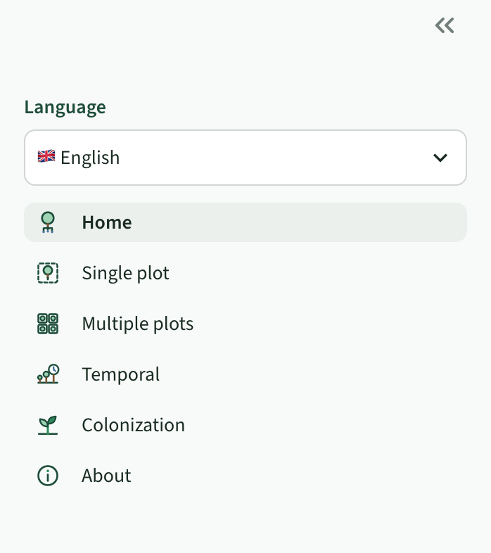

# Open the app

## Windows and macOS version (recommended)

1. Open the [Releases](https://github.com/luq317/MangueTREE/releases) page of the project and download the file of the newest version: `MangueTREE-Windows.zip` or `MangueTREE-macOS.zip`.
2. Unzip it.
3. Double-click `MangueTREE.exe` (Windows) or the `MangueTREE` application (macOS).
4. The browser opens by itself. If it does not, type `http://localhost:8501` in the address bar.

To close, use the **Quit MangueTREE** button in the sidebar. The first time, macOS may ask for confirmation to open an application downloaded from the internet (right-click, Open).

## From the source code (for programmers)

With Python 3.11 or newer, in a terminal inside the project folder:

```
pip install -e .
manguetree
```

`streamlit run src/manguetree/app/Home.py` also works. The [Desktop installers](../installers.md) page explains how to build the app for Windows and macOS.

## Language

The app opens in Portuguese. The flag at the top of the sidebar switches to English, and the choice applies to tables, charts and exports.



*Sidebar: language, pages and settings (screenshot of the app interface in English)*

