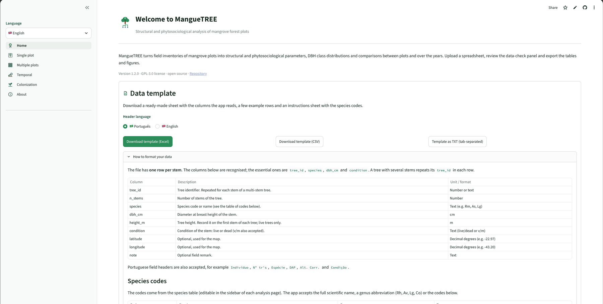
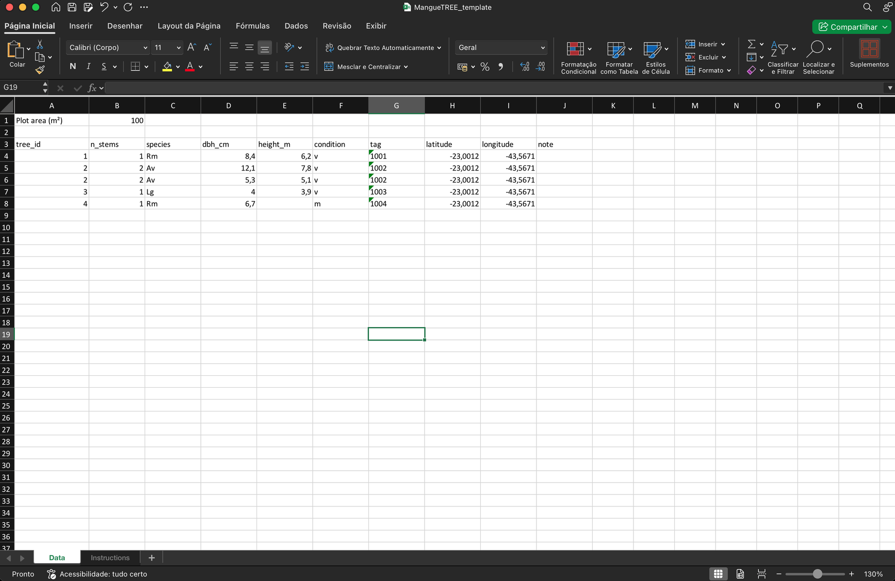

# Build the spreadsheet

MangueTREE reads a table with **one row per stem**. The easiest way to start is to download the data template on the home page.

## Data template

On the home page, before the choice of analysis, there is the **Data template** block. Choose the language of the headers (Portuguese or English) and download it as Excel (with an instructions sheet and the species codes), CSV or TXT. The **How to format your data** block inside it shows the table of columns and the species list.

*Home page: data template and How to format your data (screenshot of the app interface in English)*

## Accepted files

- **Excel (.xlsx):** one sheet per plot (multiple plots) or one sheet per year (temporal analysis, one file per plot).
- **CSV or TXT:** one plot per file, header on the first line and `;` as the separator (you can change it in the app). A CSV has no header lines, so the plot area is given in the app.

## Sheet layout

The sheet may start with a few identification lines (site, plot, year, plot area) followed by the table of stems. The app scans the first 25 rows for the first one that has the required columns and starts reading there. Blank rows are ignored.

*Example sheet: identification lines and table of stems (screenshot of the app interface in English)*

## Columns

| Column | Required | What goes in it |
| --- | --- | --- |
| Tree identifier | yes | Number or name of the tree. Repeat it for each stem of the same tree. |
| Species | yes | Scientific name, code (`Rm`, `As`...), alias or genus abbreviation (`Rh`, `Av`, `Lg`). |
| DBH (cm) | yes | Diameter at breast height of each stem, in cm. |
| Condition | yes | `v` for live, `m` for dead. |
| Number of stems | no | How many stems the tree has, used as a check. |
| Height (m) | no | Tree height, usually on its first row. |
| Latitude, longitude | no | Coordinates, for the map. |
| Tag, note | no | Field tag (repeated tags are detected) and free text. |

Column names may be in Portuguese or English, with or without accents, in upper or lower case. `DAP (cm)`, `dap` and `dbh_cm` all work. The full list of accepted names is in [Data format](../data-format.md).

## Condition, species and area

- **Condition.** Live: `v`, `vivo`, `viva`, `live`. Dead: `m`, `morto`, `morta`, `dead`. A stem with DBH and no condition is an error; by default it is left out, and the app lets you count it as live or as dead.
- **Species.** Write the scientific name, the code or a registered alias. `Av` is always *Avicennia schaueriana* (use `Ag` for *A. germinans*), `Lg` is *Laguncularia racemosa* and `Rh` is *Rhizophora mangle* in Southeast and South Brazil. Species the app does not recognise appear in the check and are not counted as species.
- **Plot area.** Write the value in m² in the sheet, next to a label such as `Plot area`, `Sampled area` or `plot_area_m2` (`1,000` is read as one thousand m²). If it is missing, the app uses the default area (100 m²) and **warns**, because the area scales every per-hectare value.
- **Numbers.** A decimal comma (`12,6`) is accepted. A blank cell is a missing value.
- **Units.** When a header states the unit, the app converts and warns: `DBH (mm)` becomes cm, `Height (cm)` becomes metres and `Area (ha)` becomes m². With no unit written, cm, m and m² apply.
- **Merged cells.** In the tree, species, condition and number-of-stems columns, the value of the first cell is repeated in the empty ones, as Excel shows it, and the app warns. DBH and height are never repeated: the height stays on the first stem only.
- **Formulas.** If the DBH column holds formulas whose results were not stored (files made by a script), open the sheet in Excel and save it again.
- **Size.** Each sheet is read up to 20,000 data rows; the app warns when there are more.

## Common mistakes

- Forgetting the condition of some stems.
- Mixing text into number columns (`12 cm`).
- Missing plot area, zero, or in the wrong unit (use m² or write `ha` in the label or the value). An area below 10 m² or above 100,000 m² is flagged.
- The same tag on more than one row.

See [Troubleshooting](10-troubleshooting.md) for what each warning means.
