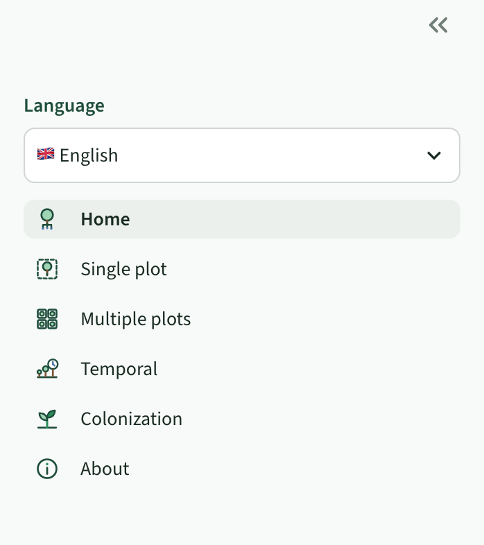
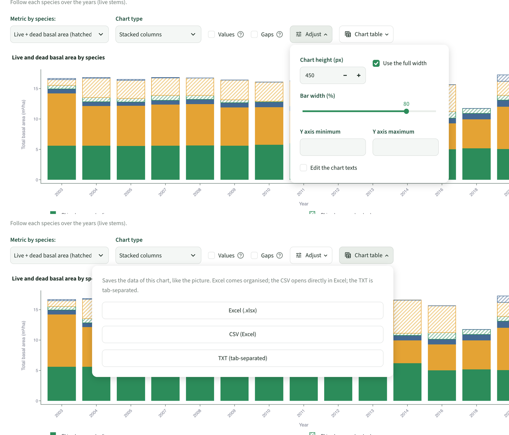

# Sidebar and settings

The sidebar is on the left of every page.

## Language and pages

At the top, the flag switches between Portuguese and English. Below it are the pages: Home, Single plot, Multiple plots, Temporal, Colonization (only shown when enabled) and About.

*Sidebar (screenshot of the app interface in English)*

## Settings shared by the analyses

- **Region.** Selects the species expected and how genus abbreviations are resolved.
- **Species table.** A menu shows the table of species and aliases. You can edit it, add species, upload your own CSV or reset it.
- **DBH class cutoffs.** Two values in cm (2.5 and 10 by default) that define three classes and the two Holdridge indices.
- **Plot area.** Read from the spreadsheet when possible. The default area (100 m²) is used only when the spreadsheet has none, and the check warns.
- **Height unit.** Metres or centimetres. It applies to tables, charts, exports and the PDF report.
- **Style.** Colour palette (MangueTREE keeps one colour per species), the MangueTREE seal on charts and **Chart settings**: title and axis font, bar width and size of all the charts of the page.

## On each chart

Above the chart there are two small buttons:

- **Adjust:** height, width, bar width, Y axis limits and texts (title, axes, legend) of that chart only.
- **Chart table:** downloads the exact data of that chart as Excel, CSV or TXT.

In the temporal analysis, these buttons sit in a single bar above the charts and apply to all of them at once.

*Adjust and Chart table buttons (screenshot of the app interface in English)*

## Figures of the open tab

Saves every chart of the open tab in a ZIP of PNG images, at the chosen resolution (150 to 600 DPI). The camera icon of each chart saves that chart alone.
