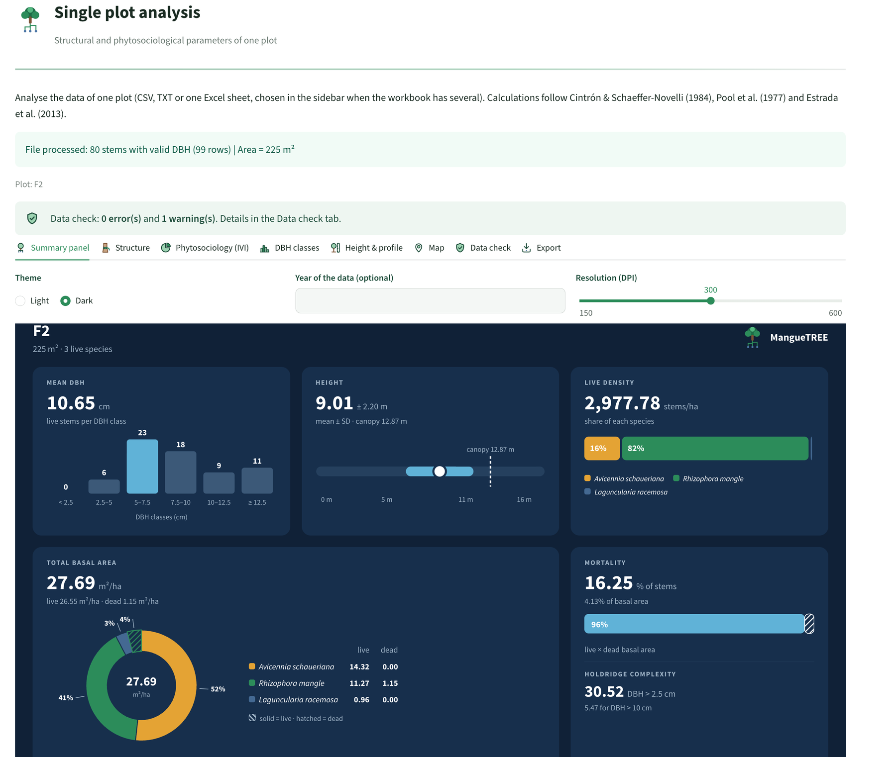
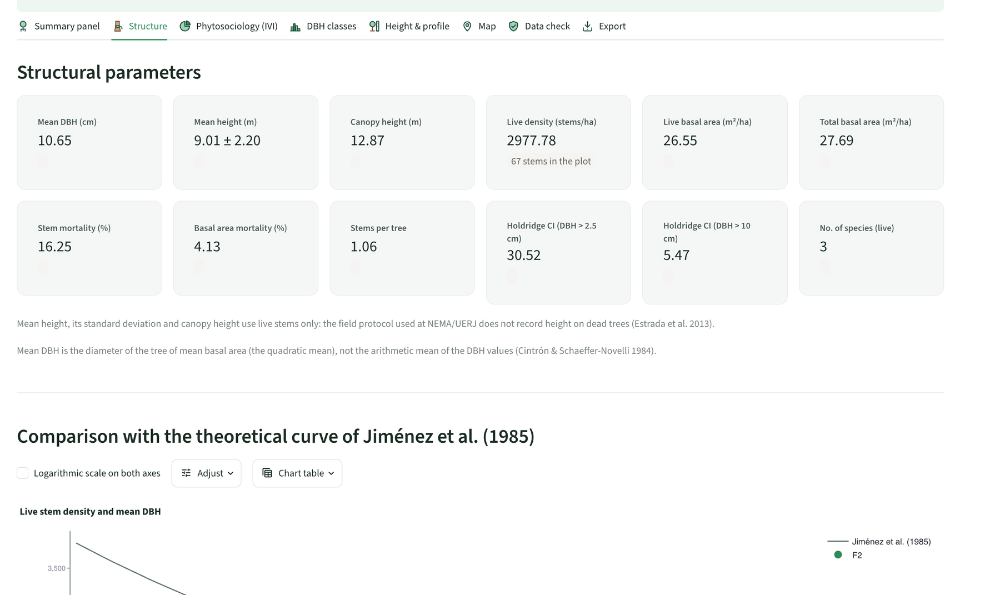
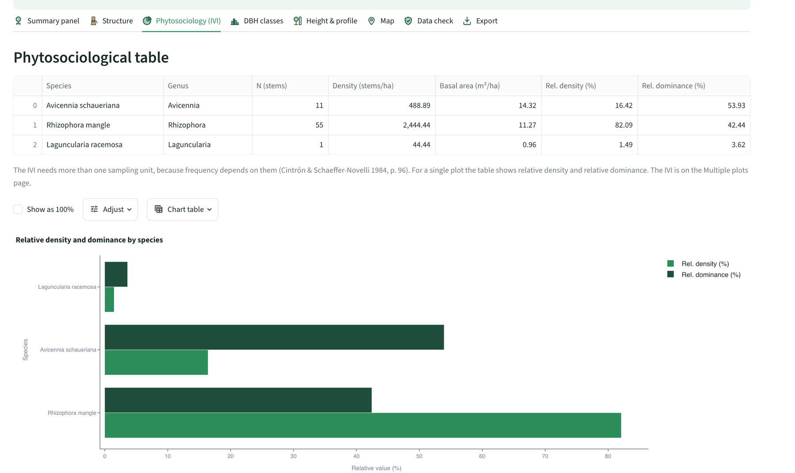
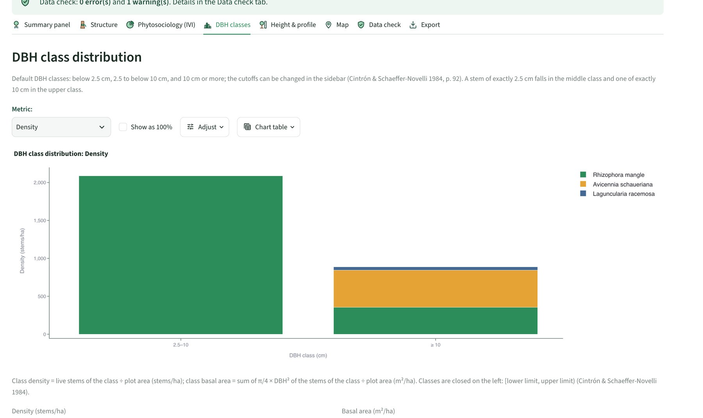
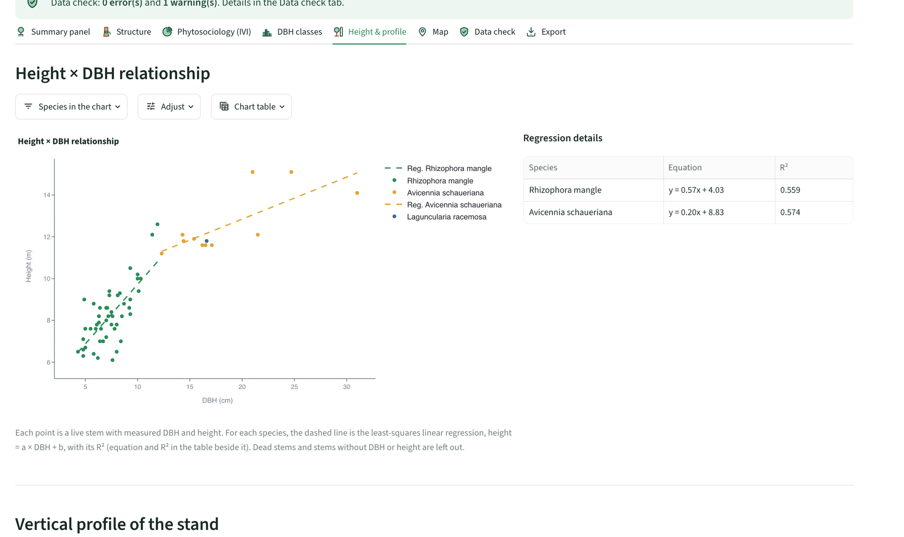

# Single plot

Use this page for one plot measured in one year.

## How to upload the spreadsheet

1. Open **Single plot** in the sidebar.
2. Upload the `.xlsx`, `.csv` or `.txt` file in the upload box.
3. If the Excel file has several sheets, pick the sheet (each sheet is one plot).
4. Check the settings in the sidebar (region, DBH classes, area, height unit).

Above the tabs a line shows the number of errors and warnings of the spreadsheet.

## The tabs

**Summary panel.** One view of the whole plot: mean DBH with the classes, height (mean ± SD and canopy), live density with the share of each species, total basal area (live solid, dead hatched), mortality and the Holdridge index. It can be downloaded as PNG or PDF.

*Summary panel of the plot (screenshot of the app interface in English)*

**Structure.** Cards with DBH, mean height, canopy height, live density (stems per hectare, with the number of stems in the plot), live basal area, total basal area, mortality, stems per tree, Holdridge indices and number of species. Below, the table by genus with the share (%) next to each value.

*Structure tab (screenshot of the app interface in English)*

**Phytosociology (IVI).** Relative density, relative dominance and, with several plots, relative frequency and IVI. The calculations are explained under the table. There are basal area composition charts and the option to show each value as a 100% column split by species.

*Phytosociology tab (screenshot of the app interface in English)*

**DBH classes.** Density or basal area by class and species (absolute or 100%), histogram and regular classes with De Liocourt's quotient.

*DBH classes tab (screenshot of the app interface in English)*

**Height and profile.** Height × DBH with a linear regression per species (choose the species and read the equations beside the chart), and the vertical profile of the plot: circles (size = DBH), stems, strata by height class or distribution by species.

*Height and profile tab (screenshot of the app interface in English)*

**Map, Data check and Export.** The map shows the points with coordinates. The check lists each problem with the spreadsheet row. Export generates the PDF report, Excel and CSV (see [Export and use the results](09-export-and-use.md)).

## How to read

- Height comes from live stems only. Canopy height is the mean of the 10 tallest live heights.
- Stems without DBH are left out of density and basal area.
- Stems of an unrecognised species count in density and basal area, but not in richness or IVI.
