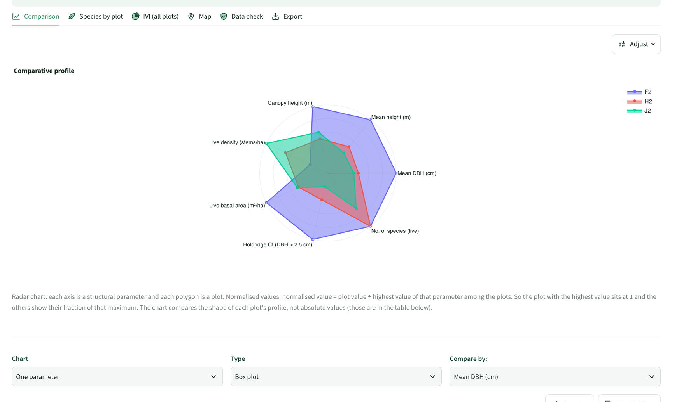
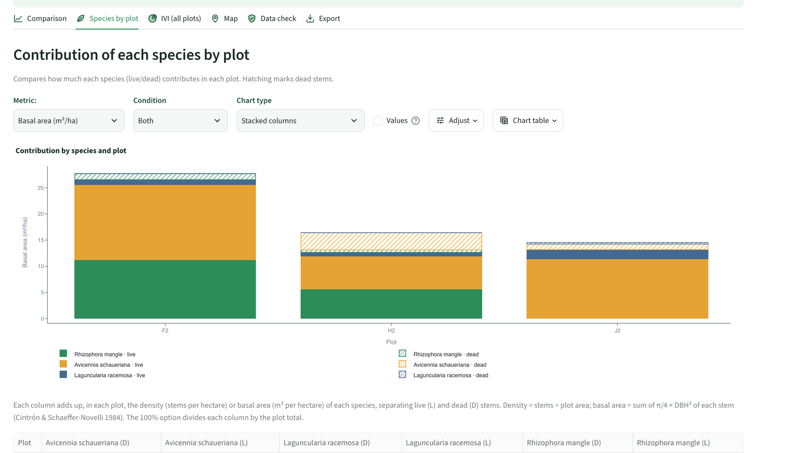

# Multiple plots

Use this page to compare plots of the same survey and calculate the IVI.

## How to upload the spreadsheet

1. Prepare **one Excel file with one sheet per plot**.
2. Open **Multiple plots** in the sidebar, upload the file and check the sidebar form.
3. Click **Run analysis**.

## The tabs

**Comparison.** First the **comparative profile** of the plots, with each parameter divided by the largest value among the plots (the equation is shown below the chart). Then a free chart: one parameter (box plot or violin of stem DBH and height, columns or line for the others), dual axis, or X × Y, with the types in collapsing menus side by side. The table gives the parameters per plot and the share of each species, live and dead.

*Comparison tab (screenshot of the app interface in English)*

**Species per plot.** Contribution of each species in each plot, live solid and dead hatched, stacked or 100%, in basal area or density (per hectare or number of stems).

*Species per plot tab (screenshot of the app interface in English)*

**IVI (all plots).** The importance value with the plots as sampling units: the explanation of the calculation is under the chart, and the table follows.

**Map, Data check and Export**, as in the single plot.
