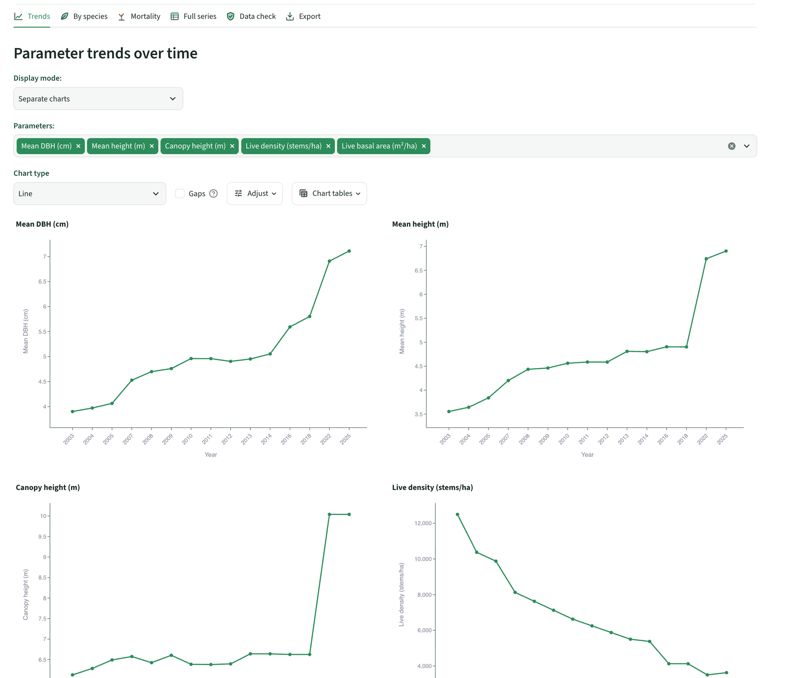
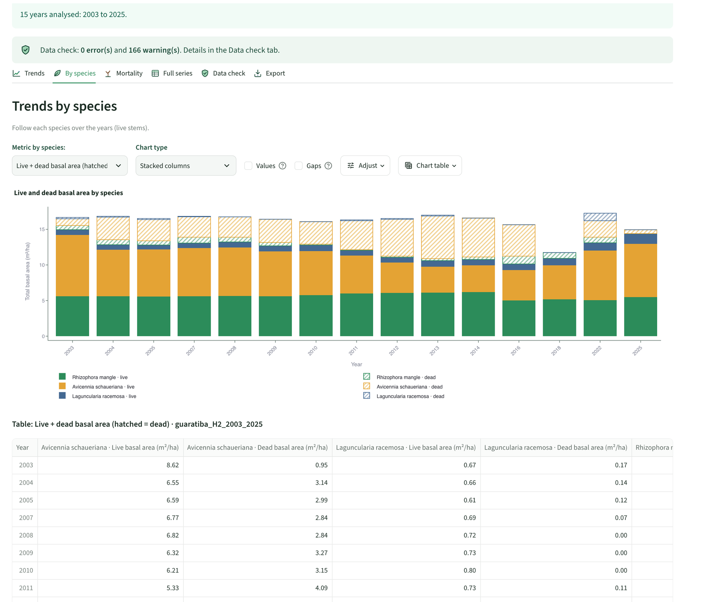
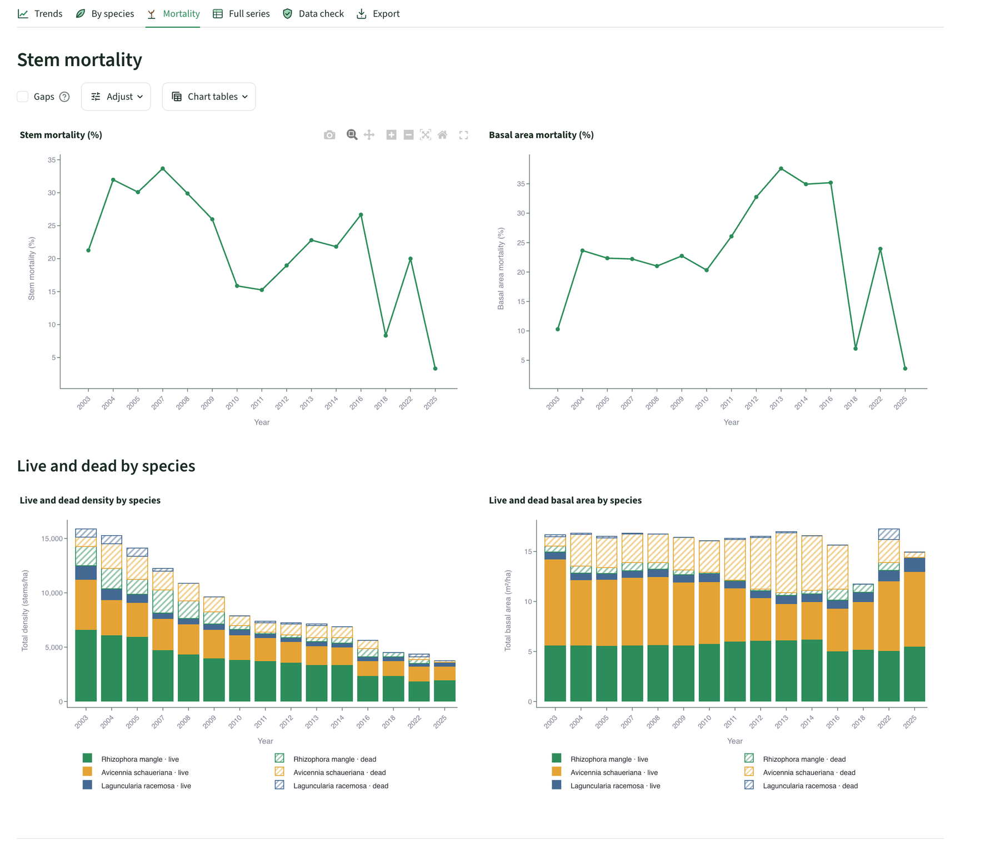

# Temporal analysis

Use this page to follow plots over the years.

## How to upload the spreadsheet

1. Prepare **one Excel file per plot**, with **one sheet per survey**. The year comes from the sheet name.
2. Open **Temporal**, upload the files (several plots can be analysed together) and click **Run temporal analysis**.
3. If a year is not found, type it. The "Check the years of the sheets" panel shows all of them.

## The tabs

**Evolution.** Any plot parameter over the years: DBH, heights, density and basal area (live, dead, total), counts, mortality, Holdridge, richness, each DBH class and stems without DBH. The chart types are line, points, columns, horizontal bars and the versions with standard deviation, in separate charts or on two axes. With several plots: one line per plot or mean ± SD. A bar above the charts has the chart type, gaps, the **Adjust charts** menu (Y limits of each chart, size and bar width) and the **Chart tables** menu (pick which tables to download).

*Evolution tab (screenshot of the app interface in English)*

**By species.** Parameters by species, opening on live and dead basal area. Lines, columns, stacked or 100% stacked, with optional values. With several plots: plots side by side, one species with the plots side by side, the difference between two plots, the mean or one plot. Species always appear in the same order (Rhizophora, Avicennia, Laguncularia, Conocarpus, others, unidentified last).

*By species tab (screenshot of the app interface in English)*

**Mortality.** Mortality in stems and in basal area, live and dead by species, and stems without DBH in each year.

*Mortality tab (screenshot of the app interface in English)*

**Full series, Data check and Export.** The full series is the table of all years.

## Years without a survey

By default the columns sit side by side. The **Gaps** option puts back the space of years without a survey.
