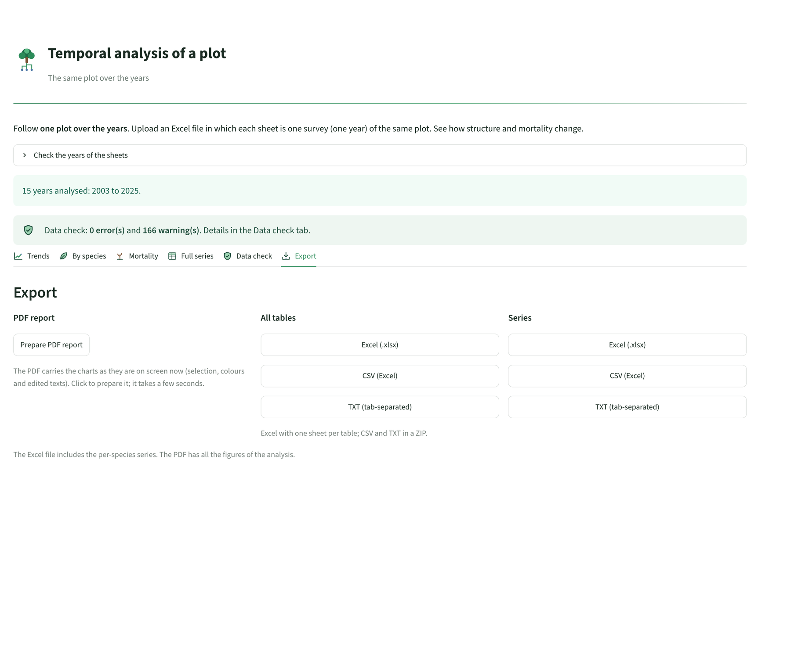

# Export and use the results

## What you can save

- **One chart as a picture:** camera icon on the chart (PNG).
- **All charts of the tab:** **Figures of the open tab** in the sidebar (ZIP of PNG, 150 to 600 DPI).
- **The data of one chart:** **Chart table** button (Excel, CSV or TXT).
- **Export tab:** PDF report in article format (with the charts of the screen itself and the data check at the end), Excel with all tables and CSV per table.

*Export tab (screenshot of the app interface in English)*

## File names

Everything the app saves carries the plot name and what the file is, with no accents or spaces: `H2_Summary-panel.png`, `H2_Tables.xlsx`, `H2_Report.pdf`, `H2_Figures.zip`. In the single plot analysis, if you fill in **Year of the data** in the summary panel, the year goes into the name (`H2_2009_Summary-panel.png`). With several plots the name lists them (`F2-H2-J2_Comparison.xlsx`; more than four becomes `7-plots_...`; a single one, `H2_Multiple_...`, so it does not repeat the single plot names), and the temporal analysis adds the plot and the years (`H2_2003-2025_Report.pdf`). Inside the ZIP, every figure has the same prefix, a sequence number and the chart title. Two charts with the same title get `-2`, `-3` in the name, so one file does not replace the other.

## Formats

- **Excel (.xlsx):** one sheet per table. It is the safest format.
- **CSV:** opens directly in Excel. In Portuguese it uses `;` and a decimal comma, in English it uses `,` and a point. If columns look glued together in another program, use Excel or TXT.
- **TXT:** tab-separated.

Results come with **two decimals** (counts stay whole). Chart axes show the complete numbers.

## Using the numbers

- For spreadsheets and statistics (Excel, R, GraphPad Prism), download the Excel or CSV and import the sheet you need.
- For the text, use the PDF: it has the main numbers, numbered figures and tables with captions, and the data check.
- Always cite the version of the app used (see the footer of the report) and the reference on the [home page](index.md).
- If the plot area came from the default, fix it before using any per-hectare value.
