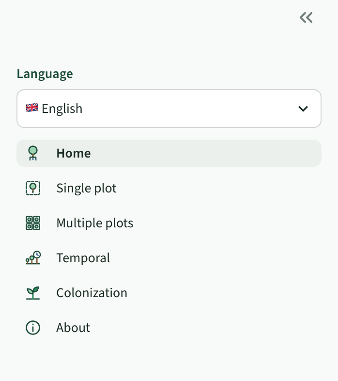

# Abrir o aplicativo

## Versão para Windows e macOS (recomendada)

1. Abra a página [Releases](https://github.com/luq317/MangueTREE/releases) do projeto e baixe o arquivo da versão mais nova: `MangueTREE-Windows.zip` ou `MangueTREE-macOS.zip`.
2. Descompacte.
3. Dê dois cliques em `MangueTREE.exe` (Windows) ou no aplicativo `MangueTREE` (macOS).
4. O navegador abre sozinho. Se não abrir, digite `http://localhost:8501` na barra de endereços.

Para fechar, use o botão **Sair do MangueTREE** no menu lateral. Na primeira vez, o macOS pode pedir confirmação para abrir um aplicativo baixado da internet (botão direito, Abrir).

## A partir do código (para quem programa)

Com Python 3.11 ou mais novo, no terminal, dentro da pasta do projeto:

```
pip install -e .
manguetree
```

Também funciona `streamlit run src/manguetree/app/Home.py`. A página [Instaladores](../installers.md) explica como gerar o aplicativo para Windows e macOS.

## Idioma

O aplicativo abre em português. A bandeira no alto do menu lateral troca para inglês, e a escolha vale para as tabelas, os gráficos e as exportações.



*Menu lateral: idioma, páginas e configurações (captura com a interface em inglês)*

