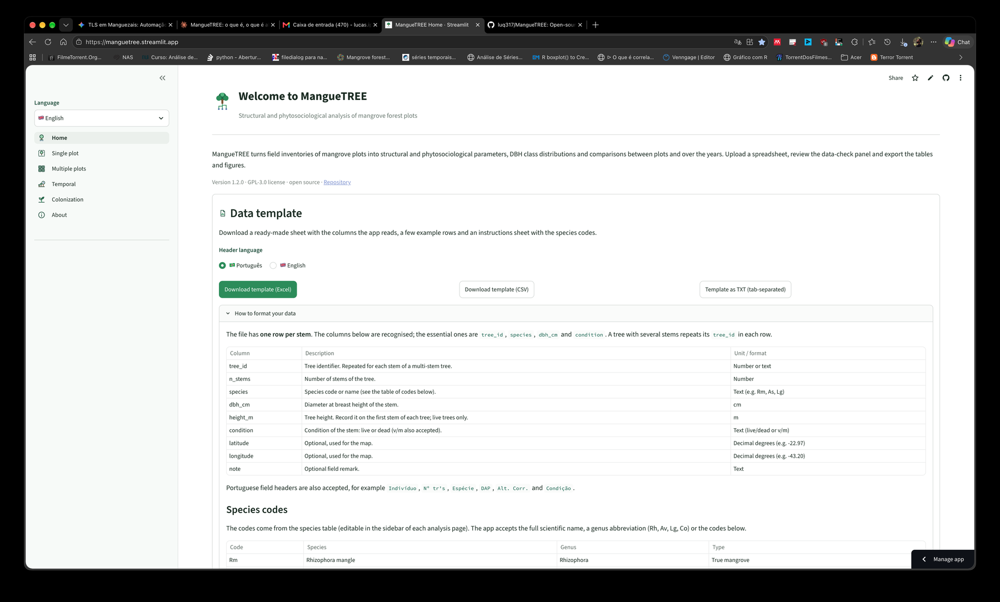
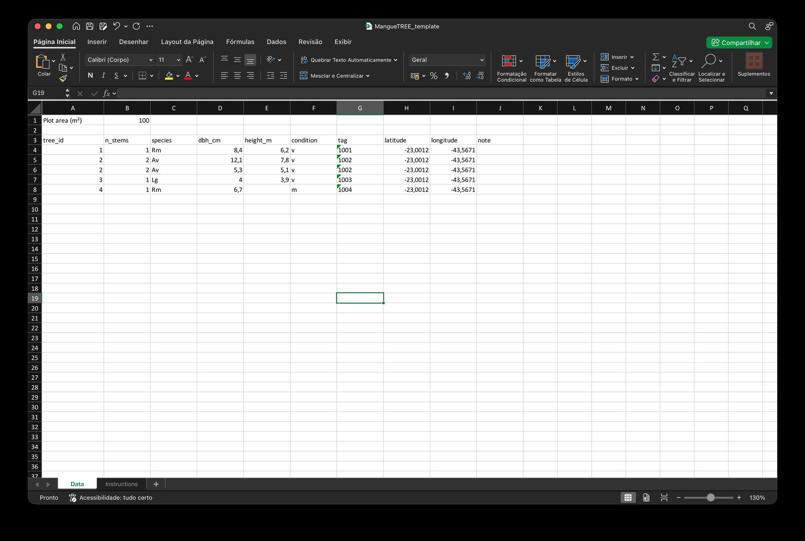

# Montar a planilha

O MangueTREE lê uma tabela com **uma linha por tronco**. A forma mais fácil de começar é baixar a planilha modelo na página inicial.

## Planilha modelo

Na página inicial, antes da escolha da análise, há o bloco **Planilha modelo**. Escolha o idioma dos cabeçalhos (português ou inglês) e baixe em Excel (com uma folha de instruções e os códigos das espécies), CSV ou TXT. O bloco **Como formatar seus dados**, dentro dele, mostra a tabela de colunas e a lista de espécies.

*Página inicial: planilha modelo e Como formatar seus dados (captura com a interface em inglês)*

## Arquivos aceitos

- **Excel (.xlsx):** uma folha por parcela (várias parcelas) ou uma folha por ano (análise temporal, um arquivo por parcela).
- **CSV ou TXT:** uma parcela por arquivo, cabeçalho na primeira linha e `;` como separador (dá para mudar no aplicativo). Como não há linhas de cabeçalho, a área da parcela é informada no aplicativo.

## Estrutura da folha

A folha pode começar com algumas linhas de identificação (local, parcela, ano, área da parcela) e depois vem a tabela de troncos. O aplicativo procura nas 25 primeiras linhas a primeira que tenha as colunas obrigatórias e começa a ler dali. Linhas em branco são ignoradas.

*Exemplo de folha: linhas de identificação e tabela de troncos (captura com a interface em inglês)*

## Colunas

| Coluna | Obrigatória | O que vai nela |
| --- | --- | --- |
| Identificador da árvore | sim | Número ou nome da árvore. Repita para cada tronco da mesma árvore. |
| Espécie | sim | Nome científico, código (`Rm`, `As`...), apelido ou abreviação do gênero (`Rh`, `Av`, `Lg`). |
| DAP (cm) | sim | Diâmetro à altura do peito de cada tronco, em cm. |
| Condição | sim | `v` para vivo, `m` para morto. |
| Número de troncos | não | Quantos troncos a árvore tem, usado para conferir. |
| Altura (m) | não | Altura da árvore, normalmente na primeira linha dela. |
| Latitude, longitude | não | Coordenadas, para o mapa. |
| Etiqueta, observação | não | Etiqueta de campo (detecta repetidas) e texto livre. |

Os nomes das colunas podem estar em português ou em inglês, com ou sem acento, em maiúsculas ou minúsculas. `DAP (cm)`, `dap` e `dbh_cm` funcionam. A lista completa de nomes aceitos está em [Formato dos dados](../data-format.md).

## Condição, espécies e área

- **Condição.** Vivo: `v`, `vivo`, `viva`, `live`. Morto: `m`, `morto`, `morta`, `dead`. Tronco com DAP e sem condição é um erro; por padrão ele fica de fora, e o aplicativo deixa você contá-lo como vivo ou como morto.
- **Espécies.** Escreva o nome científico, o código ou um apelido cadastrado. `Av` é sempre *Avicennia schaueriana* (use `Ag` para *A. germinans*), `Lg` é *Laguncularia racemosa* e `Rh` é *Rhizophora mangle* no Sudeste e Sul do Brasil. Espécies que o aplicativo não reconhece aparecem na verificação e não entram na contagem de espécies.
- **Área da parcela.** Escreva na folha, ao lado de um rótulo como `Área da parcela` ou `plot_area_m2`, o valor em m². Se não houver, o aplicativo usa a área padrão (100 m²) e **avisa**, porque a área multiplica todos os valores por hectare.
- **Números.** Vírgula decimal (`12,6`) é aceita. Célula em branco é valor ausente.

## Erros comuns

- Esquecer a condição de alguns troncos.
- Misturar texto em colunas de números (`12 cm`).
- Área da parcela ausente ou em unidade errada.
- Mesma etiqueta em mais de uma linha.

Veja [Problemas comuns](10-problemas.md) para o que cada aviso quer dizer.
