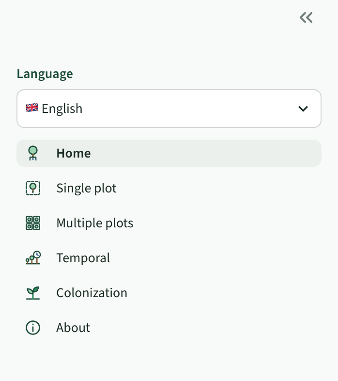
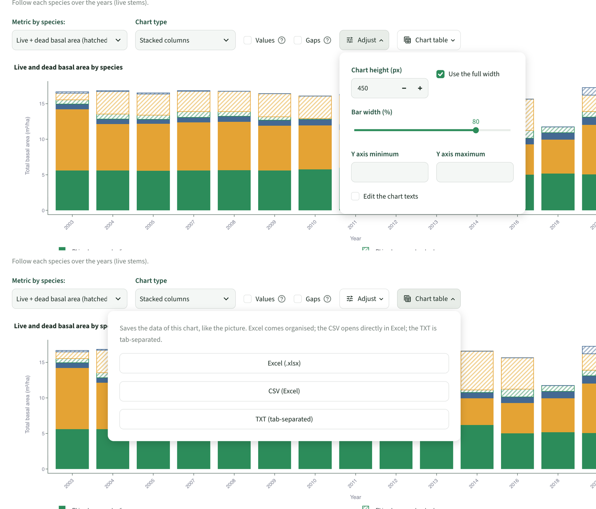

# Menu lateral e configurações

O menu lateral fica à esquerda em todas as páginas.

## Idioma e páginas

No alto, a bandeira troca entre português e inglês. Logo abaixo estão as páginas: Início, Parcela única, Múltiplas parcelas, Temporal, Colonização (só aparece quando está ativada) e Sobre.

*Menu lateral (captura com a interface em inglês)*

## Configurações compartilhadas pelas análises

- **Região.** Define as espécies esperadas e como as abreviações de gênero são resolvidas.
- **Tabela de espécies.** Um menu mostra a tabela de espécies e apelidos. Dá para editar, acrescentar espécies, subir a sua própria tabela em CSV ou voltar ao padrão.
- **Limites das classes de DAP.** Dois valores em cm (2,5 e 10 por padrão) que definem três classes e os dois índices de Holdridge.
- **Área da parcela.** Lida da planilha quando possível. A área padrão (100 m²) só é usada quando a planilha não tem área, e a verificação avisa.
- **Unidade da altura.** Metros ou centímetros. Vale para tabelas, gráficos, exportações e o relatório em PDF.
- **Estilo.** Paleta de cores (a MangueTREE mantém uma cor por espécie), selo do MangueTREE nos gráficos e **Configurações dos gráficos**: fonte do título e dos eixos, largura das barras e tamanho de todos os gráficos da página.

## Em cada gráfico

Acima do gráfico há dois botões pequenos:

- **Ajustar:** altura, largura, largura das barras, limites do eixo Y e textos (título, eixos, legenda) só daquele gráfico.
- **Tabela do gráfico:** baixa os dados exatos daquele gráfico em Excel, CSV ou TXT.

Na análise temporal, esses botões ficam em uma barra só acima dos gráficos, valendo para todos de uma vez.

*Botões Ajustar e Tabela do gráfico (captura com a interface em inglês)*

## Figuras da aba aberta

Salva todos os gráficos da aba que está aberta em um ZIP de imagens PNG, na resolução escolhida (150 a 600 DPI). O ícone da câmera de cada gráfico salva só aquele gráfico.
