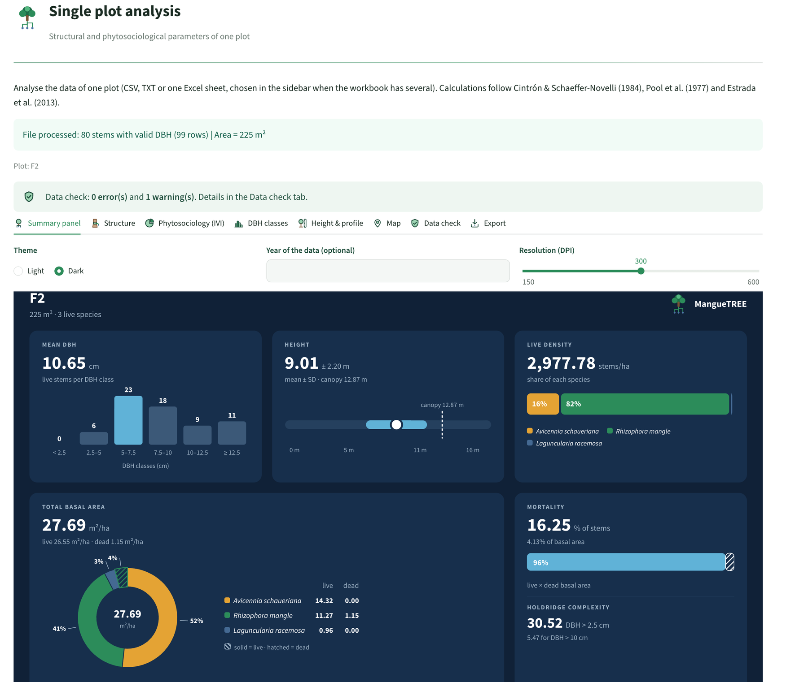
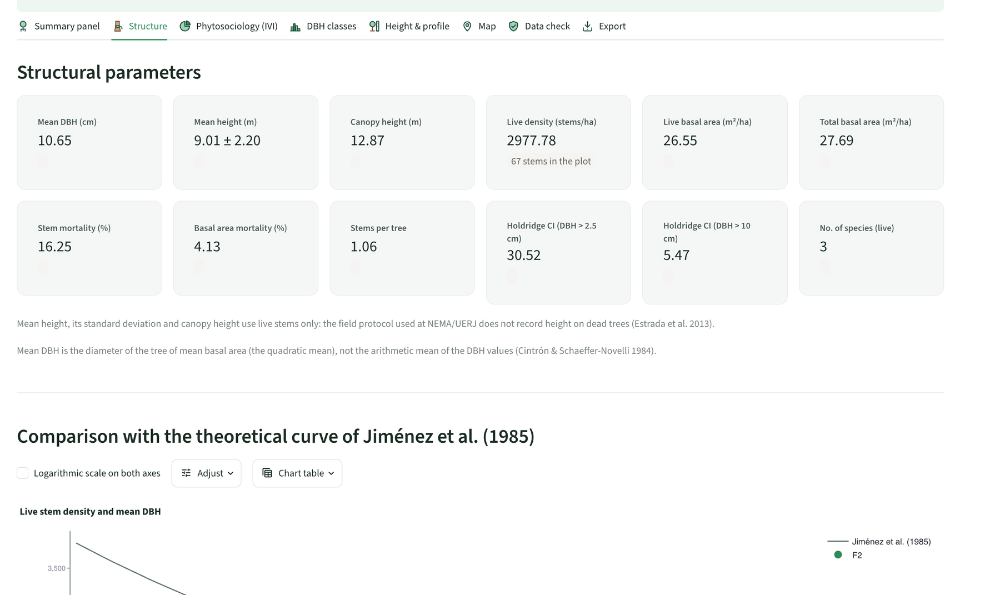
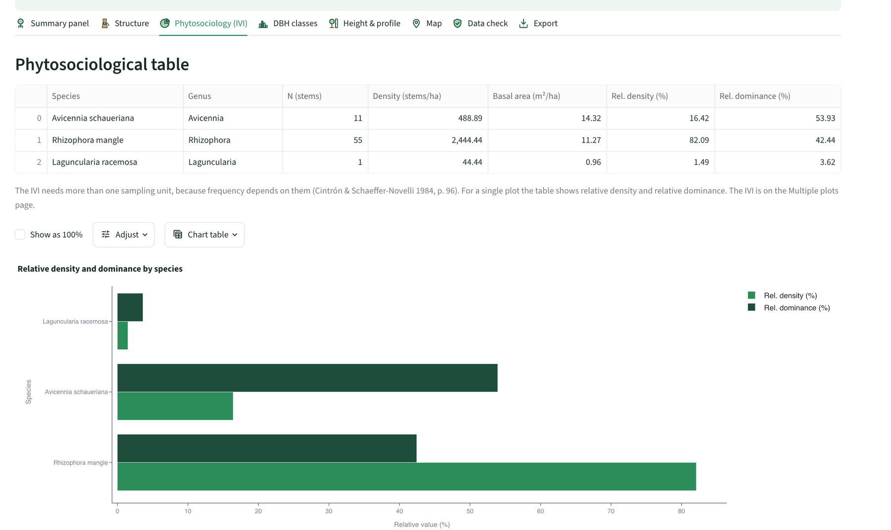
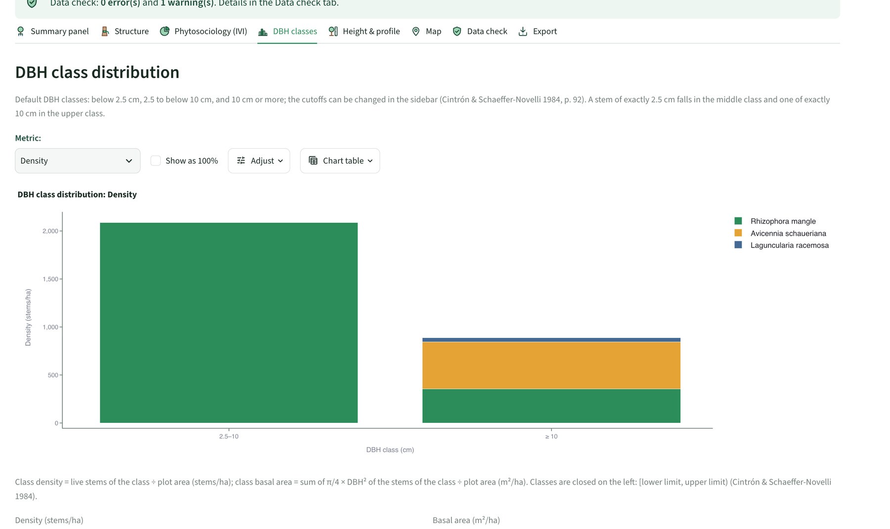
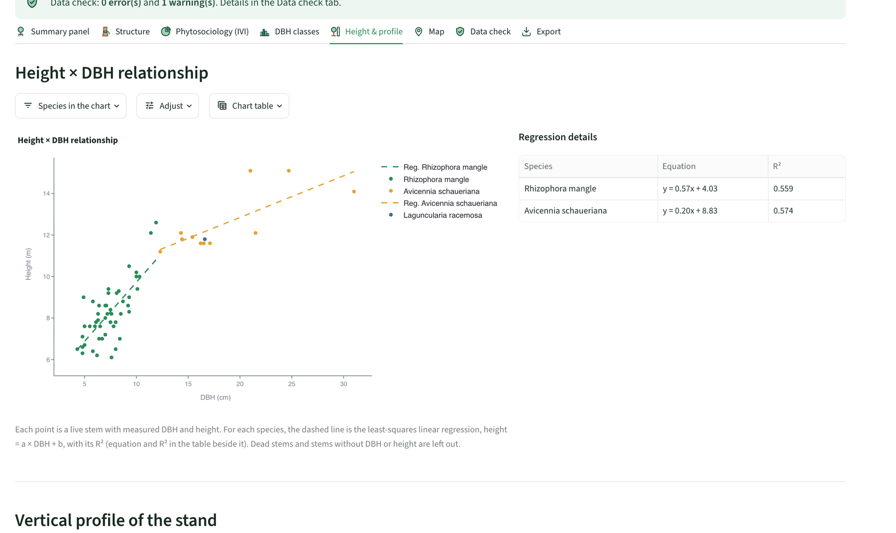

# Parcela única

Use esta página para uma parcela medida em um ano.

## Como subir a planilha

1. Abra **Parcela única** no menu lateral.
2. Envie o arquivo `.xlsx`, `.csv` ou `.txt` no campo de envio.
3. Se o Excel tiver várias folhas, escolha a folha (cada folha é uma parcela).
4. Confira as configurações do menu lateral (região, classes de DAP, área, unidade da altura).

Logo acima das abas aparece uma linha com o número de erros e avisos da planilha.

## As abas

**Painel resumo.** Uma visão da parcela inteira: DAP médio com as classes, altura (média ± desvio padrão e dossel), densidade viva com a participação de cada espécie, área basal total (viva em cor cheia, morta hachurada), mortalidade e índice de Holdridge. Dá para baixar em PNG ou PDF.

*Painel resumo da parcela (captura com a interface em inglês)*

**Estrutura.** Cartões com DAP, altura média, altura do dossel, densidade viva (troncos por hectare, com o número de troncos na parcela), área basal viva, área basal total, mortalidade, troncos por árvore, índices de Holdridge e número de espécies. Abaixo, a tabela por gênero com a participação (%) ao lado de cada valor.

*Aba Estrutura (captura com a interface em inglês)*

**Fitossociologia (IVI).** Densidade relativa, dominância relativa e, com várias parcelas, frequência relativa e IVI. Os cálculos estão explicados sob a tabela. Há gráficos de composição da área basal e a opção de mostrar cada valor como coluna de 100% dividida por espécie.

*Aba Fitossociologia (IVI) (captura com a interface em inglês)*

**Classes de DAP.** Densidade ou área basal por classe e espécie (absoluta ou em 100%), histograma e classes regulares com o quociente de De Liocourt.

*Aba Classes de DAP (captura com a interface em inglês)*

**Altura e perfil.** Altura × DAP com regressão linear por espécie (escolha as espécies e leia as equações ao lado), e o perfil vertical da parcela: círculos (tamanho = DAP), troncos, estratos por classe de altura ou distribuição por espécie.

*Aba Altura e perfil (captura com a interface em inglês)*

**Mapa, Verificação dos dados e Exportar.** O mapa mostra os pontos com coordenadas. A verificação lista cada problema com a linha da planilha. A exportação gera o relatório em PDF, Excel e CSV (veja [Exportar e usar os resultados](09-exportar-e-usar.md)).

## Como ler

- Altura vem só de troncos vivos. A altura do dossel é a média das 10 maiores alturas vivas.
- Troncos sem DAP ficam fora da densidade e da área basal.
- Troncos de espécie não reconhecida entram na densidade e na área basal, mas não na riqueza nem no IVI.
