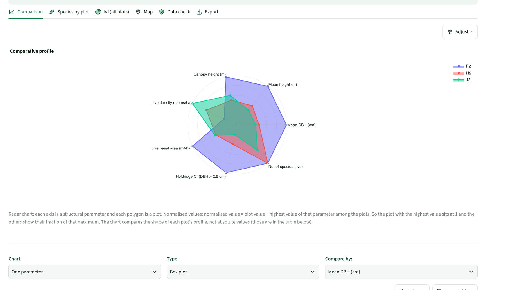
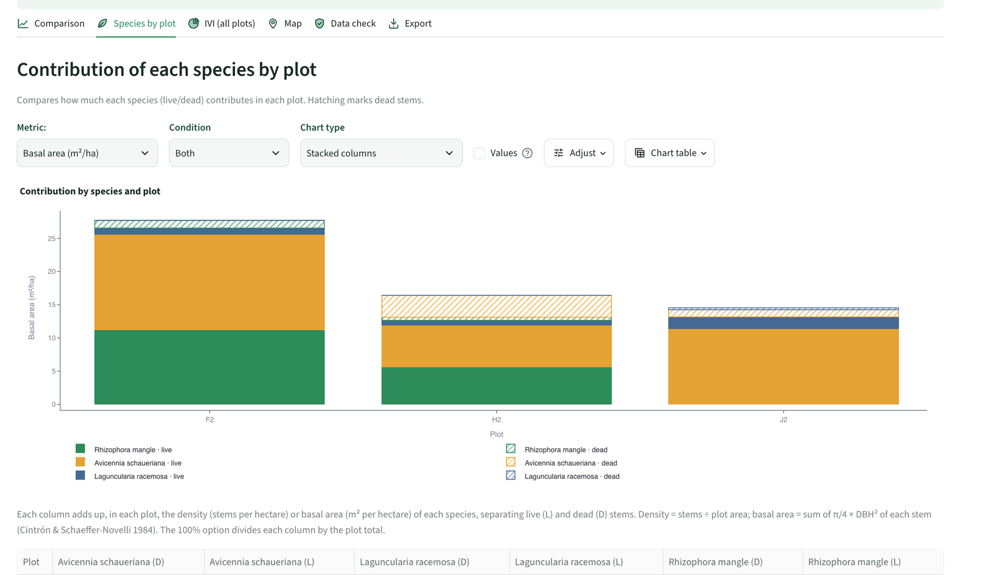

# Múltiplas parcelas

Use esta página para comparar parcelas do mesmo levantamento e calcular o IVI.

## Como subir a planilha

1. Prepare **um arquivo Excel com uma folha por parcela**.
2. Abra **Múltiplas parcelas** no menu lateral, envie o arquivo e confira o formulário do menu lateral.
3. Clique em executar.

## As abas

**Comparativo.** Primeiro o **perfil comparativo** das parcelas, com cada parâmetro dividido pelo maior valor entre as parcelas (a equação aparece abaixo do gráfico). Depois um gráfico livre: um parâmetro (caixas ou violino do DAP e da altura dos troncos, colunas ou linha para os demais), dois eixos, ou X × Y, com os tipos em menus que se recolhem, lado a lado. A tabela traz os parâmetros por parcela e a participação de cada espécie, viva e morta.

*Aba Comparativo (captura com a interface em inglês)*

**Espécies por parcela.** Contribuição de cada espécie em cada parcela, viva em cor cheia e morta hachurada, empilhada ou em 100%, em área basal ou densidade (por hectare ou número de troncos).

*Aba Espécies por parcela (captura com a interface em inglês)*

**IVI (todas as parcelas).** O valor de importância com as parcelas como unidades amostrais: a explicação do cálculo fica sob o gráfico, e a tabela vem em seguida.

**Mapa, Verificação dos dados e Exportar**, como na parcela única.
