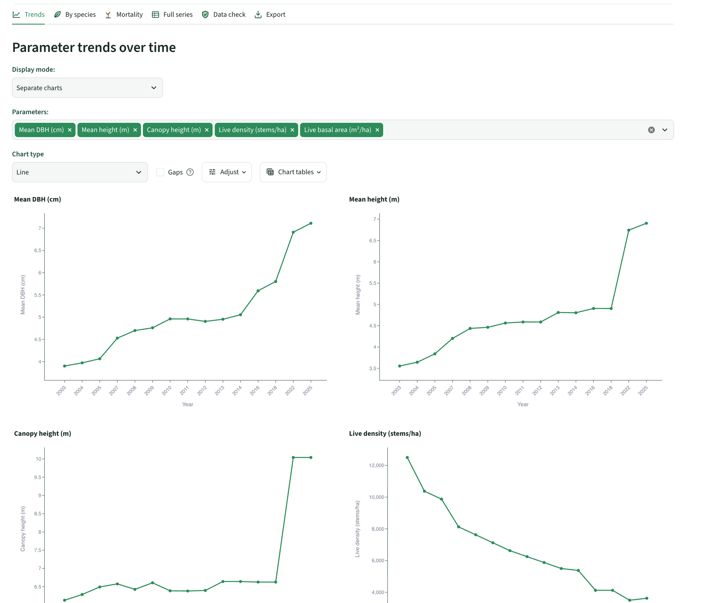
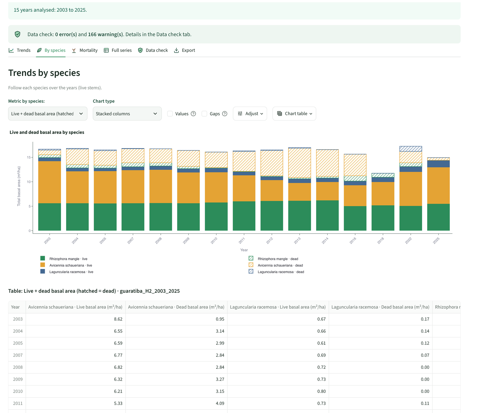
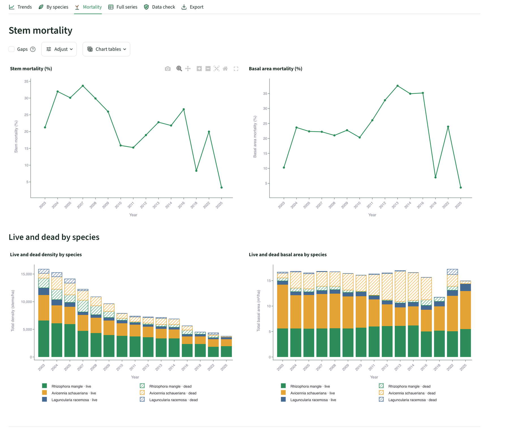

# Análise temporal

Use esta página para acompanhar parcelas ao longo dos anos.

## Como subir a planilha

1. Prepare **um arquivo Excel por parcela**, com **uma aba por levantamento**. O ano vem do nome da folha.
2. Abra **Temporal**, envie os arquivos (dá para analisar várias parcelas juntas) e clique em **Executar análise temporal**.
3. Se algum ano não for encontrado, digite-o. O painel "Conferir os anos das abas" mostra todos.

## As abas

**Evolução.** Qualquer parâmetro da parcela ao longo dos anos: DAP, alturas, densidade e área basal (viva, morta, total), contagens, mortalidade, Holdridge, riqueza, cada classe de DAP e troncos sem DAP. Os tipos de gráfico são linha, pontos, colunas, barras horizontais e as versões com desvio padrão, em gráficos separados ou em dois eixos. Com várias parcelas: uma linha por parcela ou média ± DP. Uma barra acima dos gráficos reúne o tipo de gráfico, as lacunas, o menu **Ajustar gráficos** (limites do eixo Y de cada gráfico, tamanho e largura das barras) e o menu **Tabelas dos gráficos** (escolher quais tabelas baixar).

*Aba Evolução (captura com a interface em inglês)*

**Por espécie.** Parâmetros por espécie, abrindo com a área basal viva e morta. Linhas, colunas, empilhadas ou empilhadas em 100%, com valores opcionais. Com várias parcelas: parcelas lado a lado, uma espécie com as parcelas lado a lado, a diferença entre duas parcelas, a média ou uma parcela. As espécies aparecem sempre na mesma ordem (Rhizophora, Avicennia, Laguncularia, Conocarpus, outras, não identificada por último).

*Aba Por espécie (captura com a interface em inglês)*

**Mortalidade.** Mortalidade em troncos e em área basal, vivas e mortas por espécie e troncos sem DAP em cada ano.

*Aba Mortalidade (captura com a interface em inglês)*

**Série completa, Verificação dos dados e Exportar.** A série completa é a tabela de todos os anos.

## Anos sem levantamento

Por padrão, as colunas ficam lado a lado. A opção **Lacunas** devolve o espaço dos anos sem levantamento.
