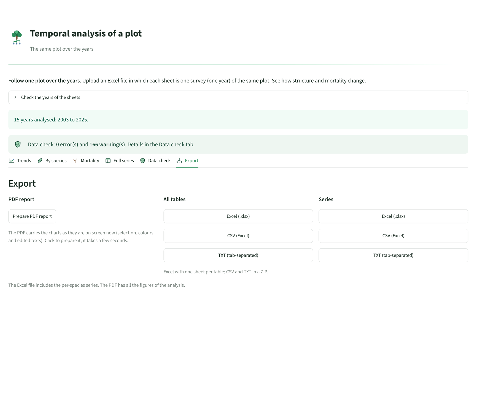

# Exportar e usar os resultados

## O que dá para salvar

- **Um gráfico como figura:** ícone da câmera no gráfico (PNG).
- **Todos os gráficos da aba:** **Figuras da aba aberta** no menu lateral (ZIP de PNG, de 150 a 600 DPI).
- **Os dados de um gráfico:** botão **Tabela do gráfico** (Excel, CSV ou TXT).
- **Aba Exportar:** relatório em PDF no formato de artigo (com os gráficos da própria tela e a verificação dos dados no fim), Excel com todas as tabelas e CSV por tabela.

*Aba Exportar (captura com a interface em inglês)*

## Nomes dos arquivos

Tudo o que o aplicativo salva leva o nome da parcela e do que é o arquivo, sem acentos nem espaços: `H2_Painel-resumo.png`, `H2_Tabelas.xlsx`, `H2_Relatorio.pdf`, `H2_Figuras.zip`. Na parcela única, se você preencher **Ano dos dados** no painel resumo, o ano entra no nome (`H2_2009_Painel-resumo.png`). Em várias parcelas o nome traz a lista delas (`F2-H2-J2_Comparativo.xlsx`; com mais de quatro vira `7-parcelas_...`; com uma só, `H2_Multiplas_...`, para não repetir o nome da parcela única) e na análise temporal traz a parcela e os anos (`H2_2003-2025_Relatorio.pdf`). Dentro do ZIP, cada figura tem o mesmo prefixo, um número de ordem e o título do gráfico. Dois gráficos com o mesmo título recebem `-2`, `-3` no nome, para um arquivo não substituir o outro.

## Formatos

- **Excel (.xlsx):** uma folha por tabela. É o formato mais seguro.
- **CSV:** abre direto no Excel. Em português usa `;` e vírgula decimal, em inglês usa `,` e ponto. Se as colunas aparecerem grudadas em outro programa, use o Excel ou o TXT.
- **TXT:** separado por tabulação.

Os resultados saem com **duas casas decimais** (contagens ficam inteiras). Os eixos dos gráficos mostram os números completos.

## Usar os números

- Para planilhas e estatística (Excel, R, GraphPad Prism), baixe o Excel ou o CSV e importe a folha desejada.
- Para o texto, use o PDF: ele traz os números principais, as figuras e tabelas numeradas, com legenda, e a verificação dos dados.
- Cite sempre a versão do aplicativo usada (veja o rodapé do relatório) e a referência da [página inicial](index.md).
- Se a área da parcela veio do padrão, corrija antes de usar qualquer valor por hectare.
